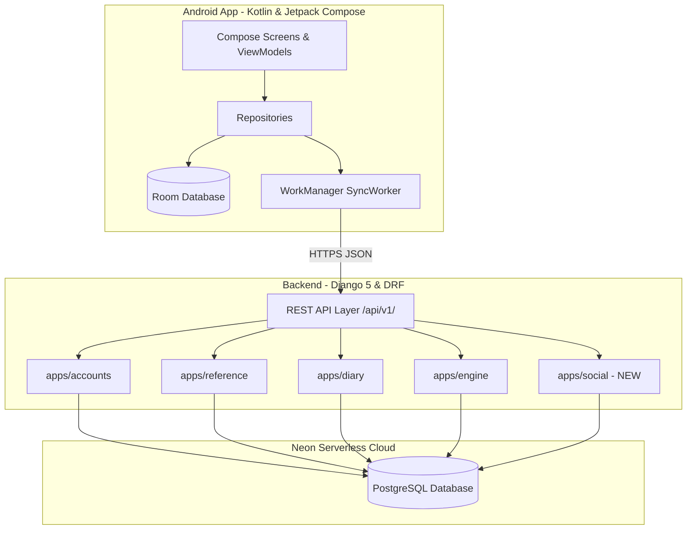
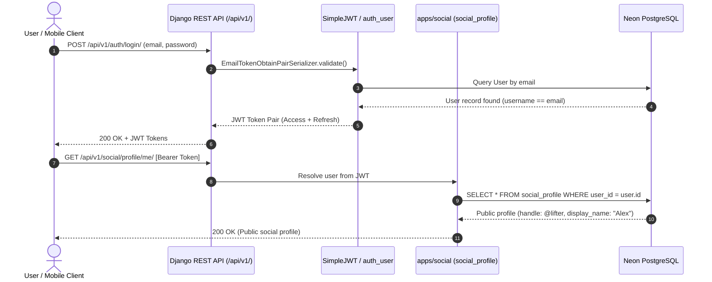

# System Architecture — FitForge

## High-Level Architectural Style

FitForge follows a **hybrid client-server architecture**:
- **Android Client**: An offline-first mobile client using Google's recommended architecture (UI Layer in Jetpack Compose, Domain Layer with pure UseCases, and Data Layer using Room + Retrofit with WorkManager synchronization).
- **Backend Service**: A modular monolithic Django REST Framework application running on Python 3.12, interfacing with serverless PostgreSQL on Neon.



---

## Interaction Diagrams

### User Authentication & Social Profile Resolution



### Workout Sync & Social Share Flow

```mermaid
sequenceDiagram
    autonumber
    actor User as User / Athlete
    participant App as Android Room DB
    participant Sync as WorkManager SyncWorker
    participant Diary as apps/diary
    participant Social as apps/social
    participant DB as Neon PostgreSQL

    User->>App: Log Sets & Complete Workout
    App->>App: Persist WorkoutSessionEntity & SetLogEntities (pending sync)
    App->>Sync: Trigger background delta sync
    Sync->>Diary: POST /api/v1/diary/sync/ (payload with client_uuid)
    Diary->>DB: INSERT INTO diary_workoutsession & diary_setlog
    DB-->>Diary: Confirmed
    Diary-->>Sync: 200 OK (Synced)

    User->>Social: Share Workout to Social Feed
    Social->>DB: INSERT INTO social_post (author_id, workout_session_id, caption)
    Note over Social,DB: Reuses diary_workoutsession.id via FK; zero workout data duplicated!
    DB-->>Social: Post Created
    Social-->>User: 201 Created (Post published to followers)
```

---

## Key Design Principles

1. **Non-Destructive Mutation**: Diary entries use a `supersedes_id` self-referencing relationship for edits, preserving historical integrity.
2. **Strict Separation of Private and Public Data**:
   - `accounts_userprofile` stores private biometrics, dates of birth, and engine configs.
   - `social_profile` stores the public handle, avatar, and bio. Private fields are never exposed over social endpoints.
3. **Pure Engine Isolation**: `apps/engine` functions are deterministic algorithms with zero ORM access, external network I/O, or clock calls, ensuring complete unit testability.
