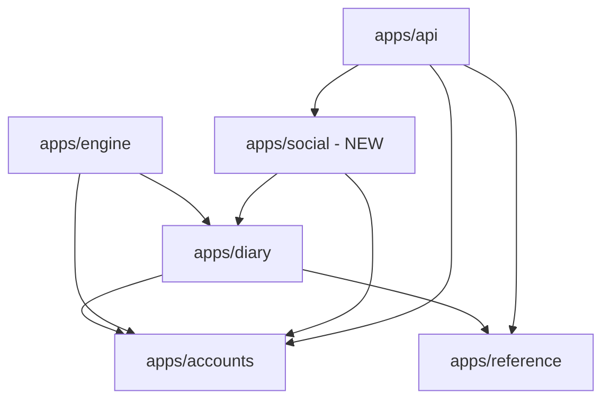

# Dependencies Analysis — FitForge Monorepo

## External Dependencies

### Backend Dependencies (`backend/requirements/base.txt`)
- `Django>=5.0,<5.1`
- `djangorestframework>=3.15,<3.16`
- `djangorestframework-simplejwt[blacklist]>=5.3,<5.4`
- `drf-spectacular>=0.27,<0.28`
- `dj-database-url>=2.1,<2.2`
- `psycopg2-binary>=2.9,<2.10`
- `python-dotenv>=1.0,<1.1`
- `whitenoise>=6.6,<6.7`
- `gunicorn>=21.2,<21.3`
- `Pillow>=10.2,<10.3`

### Android Dependencies (`android/gradle/libs.versions.toml`)
- Compose BOM: `androidx.compose:compose-bom:2024.02.00`
- Room: `androidx.room:room-runtime:2.6.1`, `androidx.room:room-ktx:2.6.1`
- Hilt: `com.google.dagger:hilt-android:2.50`
- WorkManager: `androidx.work:work-runtime-ktx:2.9.0`
- Retrofit: `com.squareup.retrofit2:retrofit:2.9.0`
- Kotlinx Serialization: `org.jetbrains.kotlinx:kotlinx-serialization-json:1.6.3`
- MediaPipe: `com.google.mediapipe:tasks-vision:0.10.9`

---

## Internal Cross-Package Dependency Graph

- `apps/engine` receives domain models and outputs pure `PlanDelta` / `UserState` objects. It does not import database models directly.
- `apps/social` depends on `apps/accounts` (for `auth_user` foreign keys) and `apps/diary` (for referencing `WorkoutSession` during social sharing).
