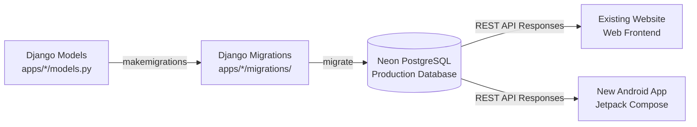

# FitForge Database Architecture & Evolution Documentation

## Overview

This directory documents the architecture of the existing FitForge database, its active schema in PostgreSQL (hosted on Neon), and the planned backward-compatible additions designed for the new Android mobile application (Kotlin + Jetpack Compose).

FitForge's core architecture serves both the existing website and the upcoming Android application from a shared backend and PostgreSQL database. To avoid service disruption or data regressions, **all database enhancements must adhere to strict backward-compatibility rules**.

---

## Relationship: Django Models, Migrations, and Neon PostgreSQL



1. **Django Models (`apps/*/models.py`)**:
   - Serve as the declarative Python schema definition.
   - Specify field types, constraints, nullability, relationships, and meta-options.
   - Must remain backward-compatible with legacy serializers, endpoints, and domain logic.

2. **Django Migrations (`apps/*/migrations/`)**:
   - Provide a deterministic, version-controlled audit trail of schema changes.
   - Each migration operation is recorded in PostgreSQL's `django_migrations` table to prevent re-execution.
   - New capabilities are added through incremental, forward-only migrations without rewriting past migrations.

3. **Neon PostgreSQL Database**:
   - Serverless PostgreSQL hosting the live dataset across 25 existing tables.
   - Connected via `DATABASE_URL` with pooled connection management (`conn_max_age=600`).
   - Acts as the single source of truth for both web and mobile clients.

---

- **Zero Breaking Changes**: Existing tables, column names, column types, and constraints must remain intact.
- **Auth Integrity**: `auth_user.username` currently stores user email addresses. This behavior is tightly coupled to website authentication (`EmailTokenObtainPairSerializer`, `SignupSerializer`) and must remain completely untouched.
- **Dedicated Community Domain**: Social and accountability features reside strictly within `apps/social/` (`social_*` tables), preventing ripple effects on `accounts`, `diary`, `reference`, or `engine`.
- **Fitness Accountability Philosophy**: FitForge is **not** a traditional social-media platform (posts, feeds, likes, comments, reels, stories, and DMs are deferred). The core is:
  ```
  COMMUNITY ──► CHALLENGE ──► PARTICIPATION ──► PROGRESS ──► STREAK
  ```
- **User Profile Architecture (Phase 1 - Complete)**:
  - **Existing**: `auth_user` (identity & web credentials), `accounts_userprofile` (private fitness & biometric data).
  - **New**: `social_profile` (public `@username` handle, display name, bio, profile image).
  - **Relationship**:
    ```
    auth_user 1 ─── 1 accounts_userprofile  (Private fitness profile)
    auth_user 1 ─── 1 social_profile         (Public social identity)
    ```
- **Reuse Over Duplication**: Challenges and streaks consume existing workout sessions (`diary_workoutsession`), set logs (`diary_setlog`), and daily state (`engine_dailystate`) through server-side calculation rather than duplicating fitness schemas or creating redundant "community_workout" tables.
- **Server-Derived Accountability (Streaks)**: Streaks and challenge progress are computed on the backend from valid stored activity. Clients never submit arbitrary streak counters.

---

## Phased Roadmap

| Phase | Domain | Status | Key Entities & Capabilities |
| :--- | :--- | :--- | :--- |
| **Phase 1** | **Social Profile** | **Complete & Verified** | `social_profile`, unique `@username` handle, profile API, discovery search, username availability check. |
| **Phase 2** | **Communities** | **Planned (Next)** | `social_community`, `social_communitymembership`, roles (owner, admin, member), public/private/invite visibility, join/leave. |
| **Phase 3** | **Challenges** | **Planned** | `social_challenge`, `social_challengeparticipation`, targets, duration, progress tracking, status lifecycle. |
| **Phase 4** | **Streaks** | **Planned** | Server-derived streaks based on valid stored activity logs; continuity/break logic. |
| **Phase 5** | **Community Challenges**| **Planned** | Custom community challenges, community-wide progress aggregation, leaderboards. |
| **Phase 6** | **Notifications** | **Planned** | Accountability alerts, challenge reminders, streak notifications. |

---

## Directory Structure

```
backend/database/
├── README.md                   # This file (overview & architecture guide)
├── schema/
│   ├── current-schema.md       # Audit of current 25 Neon tables & relationships
│   └── proposed-changes.md     # Planned backward-compatible schema modifications
├── diagrams/
│   └── erd.md                  # Comprehensive Mermaid ER diagram (Existing vs. New)
└── docs/
    └── migration-plan.md       # Phased migration roadmap, safety audit, and risk analysis
```
