# FitForge Entity-Relationship Diagram (ERD)

## Architecture Overview

This diagram represents both the **existing FitForge database schema** (currently running in Neon PostgreSQL) and the **proposed social extension** for the Android application.

- **Existing Tables**: Kept 100% intact to guarantee backward compatibility with the website.
- **New Tables (`social_*`)**: Added in a modular fashion to support Android mobile social features without touching legacy tables.

---

## Mermaid Entity-Relationship Diagram

```mermaid
erDiagram
    %% ========================================================
    %% EXISTING AUTH & ACCOUNTS DOMAIN
    %% ========================================================
    auth_user {
        int id PK
        varchar username UK "Email address in legacy website"
        varchar email
        varchar password
        boolean is_active
        boolean is_staff
        timestamptz date_joined
    }

    accounts_userprofile {
        bigint id PK
        int user_id FK,UK "1-to-1 with auth_user"
        date date_of_birth
        varchar sex_at_birth
        numeric height_cm
        numeric current_weight_kg
        numeric waist_cm
        smallint resting_hr
        varchar timezone
        varchar unit_preference
        varchar activity_level
        boolean tracks_cycle
        jsonb declined_fields
        timestamptz onboarding_completed_at
    }

    accounts_goal {
        bigint id PK
        int user_id FK
        varchar energy_direction
        varchar training_focus
        numeric target_rate_kg_per_week
        boolean auto_adjust
        timestamptz started_at
        timestamptz ended_at
    }

    %% ========================================================
    %% EXISTING REFERENCE DOMAIN
    %% ========================================================
    reference_exercise {
        bigint id PK
        varchar slug UK "Natural key"
        jsonb name
        jsonb instructions
        jsonb primary_muscles
        varchar equipment
        varchar movement_pattern
        numeric met_value
        boolean is_bodyweight
        varchar camera_position
        boolean is_active
        int updated_at_version
    }

    %% ========================================================
    %% EXISTING DIARY DOMAIN
    %% ========================================================
    diary_workoutsession {
        bigint id PK
        int user_id FK
        uuid client_uuid "UK with user_id"
        timestamptz occurred_at
        varchar utc_offset
        varchar source
        int duration_minutes
        text notes
        bigint planned_session_id FK
        bigint supersedes_id FK
    }

    diary_setlog {
        bigint id PK
        bigint session_id FK
        varchar exercise_id FK "References reference_exercise.slug"
        int user_id FK
        uuid client_uuid "UK with user_id"
        int set_index
        int reps
        numeric weight_kg
        numeric rpe
        boolean is_warmup
        varchar rom_achieved
        int tempo_ms
    }

    diary_meallog {
        bigint id PK
        int user_id FK
        uuid client_uuid "UK with user_id"
        timestamptz occurred_at
        varchar utc_offset
        bigint supersedes_id FK
    }

    diary_mealitem {
        bigint id PK
        bigint log_id FK
        int user_id FK
        uuid client_uuid
        varchar food_slug
        numeric quantity
        numeric calories
        numeric protein_g
        numeric carbs_g
        numeric fat_g
    }

    diary_weightlog {
        bigint id PK
        int user_id FK
        uuid client_uuid "UK with user_id"
        timestamptz occurred_at
        numeric weight_kg
    }

    diary_sleeplog {
        bigint id PK
        int user_id FK
        uuid client_uuid "UK with user_id"
        timestamptz bedtime
        timestamptz wake
        smallint quality
    }

    diary_cyclelog {
        bigint id PK
        int user_id FK
        uuid client_uuid "UK with user_id"
        date date
        varchar event
        varchar flow
        jsonb symptoms
        smallint energy_rating
    }

    engine_dailystate {
        bigint id PK
        int user_id FK "UK with local_date"
        date local_date "UK with user_id"
        timestamptz computed_at
        float consumed_kcal
        float burned_kcal
        float maintenance_kcal
        float target_kcal
    }

    %% ========================================================
    %% PROPOSED NEW SOCIAL DOMAIN (apps/social)
    %% ========================================================
    social_profile {
        bigint id PK
        int user_id FK,UK "1-to-1 with auth_user"
        varchar username UK "Public handle e.g. @lifter"
        varchar display_name
        text bio
        varchar profile_image
        boolean is_private
        timestamptz created_at
        timestamptz updated_at
    }

    social_follow {
        bigint id PK
        int follower_id FK "auth_user.id"
        int following_id FK "auth_user.id"
        varchar status "accepted or pending"
        timestamptz created_at
    }

    social_post {
        bigint id PK
        int author_id FK "auth_user.id"
        varchar post_type "general, workout_share, pr"
        text caption
        bigint workout_session_id FK "Nullable FK -> diary_workoutsession"
        varchar visibility
        int likes_count
        int comments_count
        timestamptz created_at
        timestamptz updated_at
    }

    social_postmedia {
        bigint id PK
        bigint post_id FK
        varchar media_url
        varchar media_type "image or video"
        smallint order
        timestamptz created_at
    }

    social_like {
        bigint id PK
        int user_id FK "auth_user.id"
        bigint post_id FK
        timestamptz created_at
    }

    social_comment {
        bigint id PK
        bigint post_id FK
        int author_id FK "auth_user.id"
        bigint parent_id FK "Self-ref for nesting"
        text content
        timestamptz created_at
        timestamptz updated_at
    }

    social_notification {
        bigint id PK
        int recipient_id FK "auth_user.id"
        int actor_id FK "auth_user.id"
        varchar notification_type
        bigint post_id FK
        bigint comment_id FK
        boolean is_read
        timestamptz created_at
    }

    social_challenge {
        bigint id PK
        int creator_id FK "auth_user.id"
        varchar title
        text description
        varchar challenge_type
        numeric target_value
        date start_date
        date end_date
        timestamptz created_at
    }

    social_challengeparticipant {
        bigint id PK
        bigint challenge_id FK
        int user_id FK "auth_user.id"
        numeric current_progress
        boolean completed
        timestamptz joined_at
    }

    %% ========================================================
    %% RELATIONSHIPS
    %% ========================================================
    %% Existing relationships
    auth_user ||--|| accounts_userprofile : "has private profile"
    auth_user ||--o{ accounts_goal : "defines"
    auth_user ||--o{ diary_workoutsession : "performs"
    auth_user ||--o{ diary_meallog : "logs meals"
    auth_user ||--o{ diary_weightlog : "logs weight"
    auth_user ||--o{ diary_sleeplog : "logs sleep"
    auth_user ||--o{ diary_cyclelog : "tracks cycle"
    auth_user ||--o{ engine_dailystate : "has daily state"

    diary_workoutsession ||--o{ diary_setlog : "contains"
    reference_exercise ||--o{ diary_setlog : "performed in"
    diary_meallog ||--o{ diary_mealitem : "contains"

    %% New Social domain connections
    auth_user ||--o| social_profile : "has public profile [NEW]"
    auth_user ||--o{ social_follow : "follower [NEW]"
    auth_user ||--o{ social_follow : "following [NEW]"
    auth_user ||--o{ social_post : "authors [NEW]"
    auth_user ||--o{ social_like : "likes [NEW]"
    auth_user ||--o{ social_comment : "comments [NEW]"
    auth_user ||--o{ social_notification : "receives [NEW]"
    auth_user ||--o{ social_challenge : "creates [NEW]"
    auth_user ||--o{ social_challengeparticipant : "joins [NEW]"

    social_post ||--o{ social_postmedia : "attaches [NEW]"
    social_post ||--o{ social_like : "receives [NEW]"
    social_post ||--o{ social_comment : "has [NEW]"
    social_comment ||--o{ social_comment : "replies to [NEW]"
    social_challenge ||--o{ social_challengeparticipant : "has participants [NEW]"

    %% Cross-domain integration (NO duplicate workout tables)
    diary_workoutsession ||--o{ social_post : "shared as highlight in [NEW]"
```

---

## Architectural Distinctions

| Domain | Entity | Visibility | Primary Purpose |
| :--- | :--- | :--- | :--- |
| **Existing Accounts** | `accounts_userprofile` | **Private** | Biometrics, DOB, onboarding flags, engine configs. |
| **New Social** | `social_profile` | **Public** | Public `@username` handle, bio, display name, avatar. |
| **Existing Diary** | `diary_workoutsession` | **User Private** | Raw workout logbook synced from Android Room. |
| **New Social** | `social_post` | **Public / Followers** | Post referencing the workout session for community feeds. |
